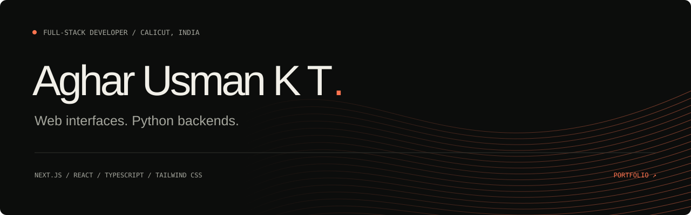
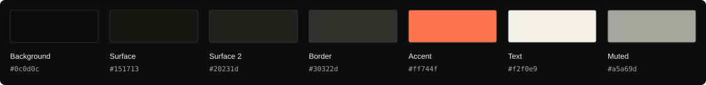

<!-- Portfolio README · Charcoal / warm white / orange -->
<div align="center">

<a href="https://aghar-portfolio.vercel.app/">
  
</a>

<a href="https://aghar-portfolio.vercel.app/">
  
</a>

# Developer portfolio

A single page for my projects, experience and the tools behind the work.  
Built with **Next.js**, **React**, **TypeScript** and **Tailwind CSS**.

[](https://aghar-portfolio.vercel.app/)
[](https://aghar-portfolio.vercel.app/resume.pdf)
[](mailto:agharusman529@gmail.com)

<br />


<br />

**[Experience](#the-experience) · [Projects](#selected-projects) · [Setup](#run-locally) · [Customization](#make-it-yours)**

</div>

## Live preview

[](https://aghar-portfolio.vercel.app/)

**[Open the portfolio ↗](https://aghar-portfolio.vercel.app/)**

<sub>Automatic screenshot via <a href="https://www.thum.io/">Thum.io</a>. No screenshot file is stored in this repository. The preview may be cached or temporarily unavailable; the live-site link always remains available.</sub>

---
## The experience

**01 / Explore the page**

A charcoal canvas, warm typography and orange details carry through the whole page. Motion responds to a purpose: navigating the work, exploring the stack, or making contact.

| Section | What happens |
| :--- | :--- |
| **Introduction** | A focused headline sits beside an interactive UI / API / SQL scope. GSAP supplies the ambient orbit; Motion connects the visual to native scrolling. |
| **Navigation** | A sticky header tracks the current section and document progress. Mobile navigation opens into a full-screen menu. |
| **Stack** | Visual tool cards pair larger technology names with real brand icons. Additional tools expand with a short Motion stagger. |
| **Experience** | A timeline pairs roles with contributions. An animated backend-flow diagram has Pause/Play controls, with additional contributions available on demand. |
| **Projects** | Image-led previews preserve their proportions and expand into a larger modal. Live/source links and implementation details stay easy to reach. |
| **Background** | A cream academic panel contrasts with the dark page, alongside languages, achievements and optional certifications. The college emblem is served locally. |
| **Contact** | Email, clipboard copying, professional profiles, résumé access and a return to the introduction. |

<details>
<summary><strong>Try the page compass</strong></summary>

The floating control ties the sections together:

1. Scroll to watch the orange ring track your progress.
2. Open the dial to see the section map.
3. Choose a section or use **Previous** and **Next**.
4. Press **Escape** to close the guide.

The control is a compact numbered dial. It stays hidden over the hero and contact section so it does not cover their controls, and appears through the middle sections. Navigation uses native browser scrolling and moves keyboard focus to the destination heading.

</details>

<details>
<summary><strong>Motion, keyboard and accessibility</strong></summary>

- Reduced-motion preferences disable the ambient orbit, sticky hero sequence, flow animations and animated transitions.
- Smaller viewports use an unpinned hero with manual UI / API / SQL controls.
- Automatically moving visuals include Pause/Play controls.
- A skip link leads directly to the main content.
- The mobile menu supports Escape, keyboard focus containment and focus restoration.
- Project disclosures use native HTML `<details>` controls; expanded screenshots use a native modal dialog with Escape support.
- Copy-email feedback is announced through a polite live region; success appears only after the clipboard write succeeds.
- The page guide is non-modal and leaves normal page navigation available.

These are implementation choices, rather than a claim of formal accessibility conformance.

</details>

## Selected projects

**02 / Work in focus**

### SU·EN Studio

An architecture and design studio website with a project archive, individual project pages, full-screen galleries and theme switching.

`Next.js` `TypeScript` `Tailwind CSS` `Framer Motion` `GSAP` `Vercel`

**[Visit the website ↗](https://suen-studio.vercel.app/)**

### Personal Portfolio

This portfolio brings the stack, experience, projects and education into one page, driven by a shared content configuration.

`Next.js` `React` `TypeScript` `Tailwind CSS` `Motion` `GSAP`

**[Visit the portfolio ↗](https://aghar-portfolio.vercel.app/)**

### AgriLeaf Pro

Plant disease detection combining a CNN, a Flask API, OpenCV preprocessing and a ThingSpeak pipeline for soil data.

`Python` `TensorFlow` `Flask` `OpenCV` `ThingSpeak` `GCP`

**[View source ↗](https://github.com/aghar-usman/Leaf-Disease-Detection-using-CNN)**

## Run locally

**03 / Start building**

With Node.js and npm installed:

```bash
git clone https://github.com/aghar-usman/Portfolio.git
cd Portfolio
npm ci
npm run dev
```

Open [localhost:3000](http://localhost:3000), or the address printed by Next.js.

For a production build:

```bash
npm run build
npm run start
```

Run these commands in the folder containing `package.json`. Motion and GSAP are project dependencies installed by npm; the optional `motion-ai` coding skill is not required to run the website.

## Make it yours

**04 / Content & design**

### Content

The `@/data` module supplies the profile, contacts, skill groups, experience, projects, education, certifications, achievements, languages and navigation links.

Update that content first. Keep Skills connected to the shared configuration:

```tsx
<Skills skills={skillGroups} />
```

<details>
<summary><strong>Add a project screenshot</strong></summary>

Place a real screenshot in `public/images/`, then add this field to its project entry:

```ts
screenshot: {
  src: "/images/suen-studio.webp",
  alt: "SU·EN Studio homepage showing the architecture project gallery",
},
```

If the content module has its own `ProjectEntry` interface, add:

```ts
screenshot?: { src: string; alt: string };
```

For a sharp production preview, use a screenshot around **1600–2400px wide**, without browser chrome or private information. The image keeps its natural proportions and can be expanded. Local screenshots take priority over the automatic SU·EN Studio preview; image failure leaves the project details and live-site link available.

</details>

<details>
<summary><strong>Change the theme</strong></summary>



The shared tokens live in the global stylesheet:

| Token | Value | Purpose |
| :--- | :--- | :--- |
| `--color-bg` | `#0c0d0c` | Main charcoal background |
| `--color-surface` | `#151713` | Alternating sections and controls |
| `--color-surface-2` | `#20231d` | Secondary surfaces |
| `--color-border` | `#30322d` | Dividers and outlines |
| `--color-accent` | `#ff744f` | Orange actions and highlights |
| `--color-text` | `#f2f0e9` | Warm primary text |
| `--color-text-muted` | `#a5a69d` | Supporting text |

Inter and JetBrains Mono are loaded with `next/font/google` and connected to the shared font tokens. System fonts provide fallbacks. The education panel reverses to warm paper with dark text. Set `--site-header-height` to the actual navbar height; the default is `80px`.

</details>

<details>
<summary><strong>Understand the layout</strong></summary>

```text
Home
├── Navbar
├── main
│   ├── Hero
│   ├── Skills
│   ├── Experience
│   ├── Projects
│   └── EducationAndExtras
├── Footer / Contact
└── PageGuide
```

Each section owns its maximum width, responsive gutters and vertical spacing. The page wrapper stays full-width, so alternating backgrounds reach the viewport edges. Avoid adding another narrow container or large gaps around these sections.

The interaction layer uses React, Motion (`motion/react`), GSAP and native browser features. Scoped animation cleanup, reduced-motion support and manual controls keep the interactions manageable. No Motion+ package is required.

The college emblem lives at `public/college-logo.jpg`. The `screenshot` fields in project data are optional.

</details>

## Before publishing

- [ ] Confirm all contact, project and credential URLs.
- [ ] Place the résumé at `public/resume.pdf`, or update its URL.
- [ ] Check the page at desktop, tablet and mobile widths.
- [ ] Test keyboard navigation, menu closing and section destinations.
- [ ] Test reduced motion, Pause/Play and clipboard success/failure.
- [ ] Verify image expansion, Escape and focus restoration.
- [ ] Check automatic previews; use local images when reliability or sharpness matters.
- [ ] Check screenshots for readable content and private information.
- [ ] Run the production build and review the built site.

---

<div align="center">

### Let’s build something extraordinary together.

Have a development role or a website project in mind?  
I’d like to hear about it.

[](mailto:agharusman529@gmail.com)
[](https://linkedin.com/in/aghar-usmankt)
[](https://github.com/aghar-usman)

<br />

<sub>Aghar Usman K T · Calicut, Kerala, India</sub>

[Back to top ↑](#developer-portfolio)


</div>
